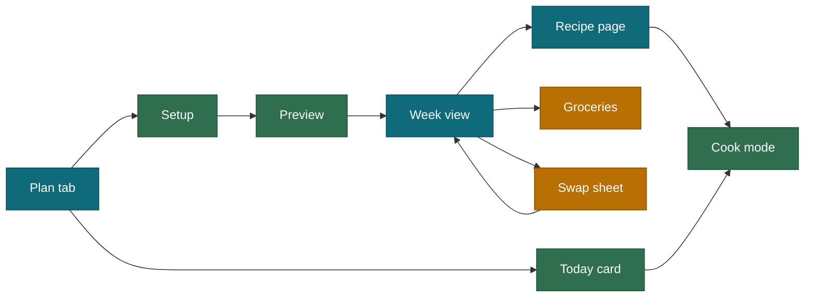

# UI and UX research: Protein Kitchen

Status: research and recommendations, 2026-10-22. Scope: the plan-setup flow, week preview, swaps, groceries, cook mode, Today card, and the PWA constraints that shape them. Product intent is in `PLAN.md`; this document turns it into interaction decisions.

## 1. The brief, restated

The user picks how many days, which meal types, and which ingredients they like. The app plans the meals from the profile (weight, protein target, calorie target, diet). It must be quick enough for a Sunday, usable one-handed in a kitchen or supermarket, and honest when a request cannot be met.

Success is behavioural, not visual: the plan gets made and used. `PLAN.md` already sets the bar (setup under 3 minutes, adoption check after two skipped Sundays). This document adds a tighter target for setup alone: **median under 60 seconds on a repeat run, one tap when nothing changed.**

## 2. What the evidence says

Confidence is stated per finding. Vendor blogs and secondary write-ups are marked as such; I could not reach several primary sources (Nielsen Norman Group, WebKit, Apple HIG) through search, so those claims need a check before they are treated as settled.

### 2.1 Competitor patterns

| Finding | Source | Confidence |
|---|---|---|
| Eat This Much uses a long onboarding (reported as 17 steps) that starts with account creation and body metrics, then diet type. Reviewers call it thorough; one reviewer found the app overwhelming at first and relied on the built-in tour. | [PlanToEat review](https://www.plantoeat.com/blog/2023/10/eat-this-much-app-review-pros-and-cons/) | Medium: a competitor's blog, 2023 |
| Eat This Much lets users add or remove meal times (extra snacks, dessert) and mark foods as recurring. Complaints: the weekly shopping list is huge and recipe variety forces many different purchases. | Same | Medium |
| A hands-on test found multi-day editing easier on a computer than on the phone, and the free tier limited to single-day plans. | [CNN Underscored](https://amp.cnn.com/cnn/cnn-underscored/reviews/best-meal-planning-apps) | Medium: test date unclear |
| Mealime asks for diet type, then allergens and disliked ingredients, and filters recipes with them. The user chooses how many meals to plan (a 2016 review says 2 to 6) and either builds the plan manually or lets the auto-builder propose one. Swapping is a tap on a meal photo; swiping gets a whole new plan. The grocery list is grouped by store department and shows which recipe each item is for. | [Mealime getting-started guide](https://support.mealime.com/article/151-getting-started-guide), [Food & Nutrition review](https://foodandnutrition.org/july-august-2016/mealime-version-2-0/) | Medium: servings numbers disagree between sources |

Takeaways for us:

- The proven shape is **propose, then swap**. That matches PLAN.md rule 1.
- Dislikes and allergens as a filter is standard. We add positive likes, which most competitors treat less prominently, and the anchor-protein data makes that possible.
- A giant list is a known complaint. Our recipes share components and ingredients on purpose, and the grocery screen should show how many distinct items a plan needs so people can tune it.
- Long onboarding is tolerated by dedicated trackers but is the opposite of our "three minutes on Sunday" rule. We ask once, remember it, and prefill.

### 2.2 Why people abandon food apps

- A study of 141 current and lapsed users of MyFitnessPal, FatSecret and Calorie Count, plus 5,526 forum posts, found that social features did not create the hoped-for feedback loop. A cited figure says only 3 percent of 190,000 downloads of one food-journal app led to use beyond a week. Source: [Big Think summary](https://bigthink.com/ideafeed/why-so-many-people-quit-food-logging-apps-in-the-first-week) of the CHI paper. Confidence: medium; I did not read the paper itself.
- A 2026 report from a competing calorie app (Nutrola) lists "too time-consuming to log" as the top quit reason at 34 percent. Source: [Nutrola churn report](https://nutrola.app/en/blog/120k-first-app-churn-90-day-data-report-2026). Confidence: low. It is a vendor report with no published method.
- I found no rigorous study comparing meal-planner retention with food-logging retention.

Takeaway: friction in recurring effort is the consistent theme, even in weak sources. This supports the existing rule: **no food logging, ever**. Tick-offs (habits, groceries, prep tasks) are the only recurring input.

### 2.3 Mobile ergonomics and standards

| Finding | Source | Confidence |
|---|---|---|
| WCAG 2.2 SC 2.5.8 (AA) requires pointer targets of at least 24 by 24 CSS pixels, or enough spacing around smaller ones. SC 2.5.5 (AAA) asks for 44 by 44. | [Tabnav](https://tabnav.com/academy/wcag/success-criterion-2.5.8), [BOIA](https://www.boia.org/blog/understanding-target-size-under-wcag-2.2-and-how-it-affects-people-with-disabilities) | High: consistent across sources |
| Apple recommends 44 by 44 points for controls. Treat it as a guideline, not a conformance rule. | [Deque](https://dequeuniversity.com/rules/attest-ios/1.0/touch-target-size) | Medium: secondary, Apple's page not reached |
| In an observational study of 1,333 people on the street, 49 percent held the phone one-handed, 36 percent cradled it, 15 percent used two hands; thumbs did most of the touching. The effortless reach zone is the lower part of the screen. Hoober himself says the thumb-zone diagrams are over-read, and that people touch the centre of the screen most accurately. | [UXmatters](https://www.uxmatters.com/mt/archives/2013/02/how-do-users-really-hold-mobile-devices.php) | Medium: small observational study |
| Chips: keep one selection behaviour per flow, show the most important 3 to 5 on mobile first with a way to reveal the rest, 40 px targets with at least 8 px between them. | [Volvo design system](https://designsystem.volvocars.com/web/components/chips/usage/) | Low to medium: one design system's convention |
| Bottom sheets suit supplementary content, filters, short forms and 3-plus quick actions. They are a poor fit for central, multi-step or attention-heavy tasks. | [Material](https://material.io/components/sheets-bottom), [KLM](https://design.klm.com/latest/components/bottom-sheet/usage-BbiVuOqR) | Medium: several design systems agree |
| Recognition beats recall; sensible defaults cut memory load and effort. | [NN/g video on recognition vs recall](https://www.nngroup.com/videos/recognition-vs-recall/) | Medium |

Takeaway: use 44 px targets as the project standard (already in CLAUDE.md). Put the primary action at the bottom. Use bottom sheets for **swap** and **ingredient picking**, not for the whole setup.

### 2.4 PWA and platform constraints

| Finding | Source | Confidence |
|---|---|---|
| iOS web push works only for web apps installed to the home screen, needs a manifest and HTTPS, and the permission prompt must follow a user action. In a Safari tab, the push API is unavailable. | [Pushpad](https://pushpad.xyz/blog/ios-special-requirements-for-web-push-notifications), [OneSignal](https://documentation.onesignal.com/docs/web-push-for-ios), [MagicBell](https://www.magicbell.com/blog/pwa-ios-limitations-safari-support-complete-guide) | Medium to high: consistent across vendors |
| Safari caps script-writable storage after seven days of Safari use without interaction. Home screen web apps have their own usage counter and are largely exempt, but one user report says a home-screen app still lost its login. | [WebKit storage posts](https://webkit.org/blog/category/storage), [Search Engine Land](https://searchengineland.com/what-safaris-7-day-cap-on-script-writeable-storage-means-for-pwa-developers-332519) | Medium: 2020 material, current policy not confirmed |
| In the EU, home screen web app support on iOS has been unstable. Status uncertain. | [MobiLoud](https://mobiloud.com/blog/progressive-web-apps-ios) | Low: check before relying on it |
| The Screen Wake Lock API keeps the screen on, recipe apps are a named use case, it needs HTTPS and a user gesture, and the toggle should be hidden where unsupported. | [Chrome developers](https://developer.chrome.com/docs/capabilities/web-apis/wake-lock) | High; browser support figures disagree between sources |
| `navigator.share` accepts a newline-joined `text` string, needs transient activation (call it straight from a click handler), and is missing on most desktop Firefox. | [web.dev](https://web.dev/web-share) | High |

Takeaways:

- **The server is the source of truth.** The app runs on a home server via Tailscale, so plans, ratings and preferences live in SQLite. Treat the browser cache as a convenience, never the only copy.
- Cache only what must work offline: the grocery list and the current week.
- Nudge "Add to Home Screen" once, then ask for notification permission only after a tap.
- Always provide **Copy as list** next to **Share**, because sharing is not universal.

## 3. Design principles

1. **Defaults first.** Every setup field is prefilled from the profile or the last run. The user changes things, not fills them.
2. **One decision per row.** Row height 56 px or more, one control per row.
3. **Thumb-first layout.** Primary action docked at the bottom. Rarely used controls go in the top bar.
4. **Honest plans.** If the target cannot be met, show the gap and offer a fix. Never relax the target quietly.
5. **No data entry in the kitchen.** The only recurring input is a tick.
6. **Recognition over recall.** Show recipe names, protein figures and anchor ingredients on every tile so nobody has to remember.
7. **Numbers are never decoration.** Protein per serving and kcal appear wherever a recipe appears.

## 4. Information architecture

Three tabs, as in PLAN.md: **Plan**, **Recipes**, **Groceries**. Settings and profiles are a sheet. The setup flow is entered from the Plan tab's primary button.



## 5. Plan setup: the key screen

Single scrolling screen, four blocks, sticky **Generate plan** button. Wireframe for a 390 px wide phone:

```
+--------------------------------------+
|  New plan                       [x]  |
+--------------------------------------+
|  For   [x Nitin] [ Asha ] [+ Add]    |   tick one or more people
|  Nitin  120 g protein  ~2,100 kcal   |   per-person targets, tap to edit
|                                      |
|  Length                              |
|  [7 days] (14 days) (Custom)         |   single select chips
|  Mon 3 Nov  ->  Sun 9 Nov            |   range, tap to edit
|                                      |
|  Meals                               |
|  [Breakfast] [Lunch] [Dinner]        |   multi select toggles
|  [Snack]  ( Shake )                  |
|                                      |
|  You like                       Edit |
|  [Paneer] [Tofu] [Soya] [Rajma] ...  |   anchor chips, 3 to 5 visible
|  + 12 more                           |
|                                      |
|  Avoid                          Edit |
|  [Mushroom]                          |
|                                      |
|  More options  v                     |   closed by default
|    Indian <------o-----> Global      |
|    Weeknight only (20 min or less)   |
|    Pin recipes: 0                    |
+--------------------------------------+
|        [  Generate plan  ]           |   sticky, 56 px
+--------------------------------------+
```

### 5.1 Behaviour decisions

| Decision | Choice | Reason |
|---|---|---|
| Plan length | Chips: 7 days, 14 days, Custom. Custom opens a date range picker (1 to 31 days). The range line under the chips always shows the real dates | Owner decision. Three chips respect the chip guidance; the range keeps flexibility without a second screen |
| Meal types | Multi-select toggles. Breakfast, lunch, dinner and snack are on by default. Shake is always off and only the user can turn it on. If a day falls short with Shake off, the preview banner offers "Add shake" | Different behaviour from days chips, so give them a different shape (toggle with check mark) |
| Likes | Anchor-protein chips first (paneer, tofu, soya, rajma, chole, moong, dahi, tempeh, edamame), then "+ N more" opens a **full-screen picker**, not a half sheet | Searching and grouping 240 ingredients is a central task. Bottom-sheet guidance says avoid sheets for attention-heavy flows |
| Ingredient search | Matches name and aliases, so "rajma", "kidney beans" and "rajmah" all hit | The data already holds Hindi and Punjabi aliases |
| Avoid list | Separate from likes, same picker with a mode switch | Avoids ambiguity of one list with two meanings |
| Profiles | Multiple from day one. Tick the people eating this plan; each person's target is shown and editable from the setup screen | Owner decision. Targets are configurable per profile and edited rarely, so they stay in a sheet |
| More options | Collapsed accordion | Progressive disclosure; most runs never open it |
| Repeat run | The last setup is loaded. If nothing changes, the user taps **Generate plan** immediately | One-tap path |

### 5.2 Ingredient picker

- Full screen with search at the top and group tabs (Proteins, Legumes, Dairy, Vegetables, Grains, Other). The keyboard never covers the selected chips; selected items pin above the keyboard.
- Each row: name, a small protein-per-100-kcal figure, and a three-state control: neutral, like, avoid. Tapping cycles the state, and a long tap is not required.
- Show a live counter: "Liked 6, avoided 2". Footer button: **Done**.
- Likes bias the generator, they do not hard-filter. The preview says how many planned meals use a liked ingredient.

### 5.3 What the generator needs from the data

| Need | Where it comes from |
|---|---|
| Which ingredients a recipe uses | `items`, expanded through components |
| Which ingredient is a recipe's anchor protein | `anchorIngredients()` in `lib/nutrition/macros.ts` (shipped) |
| Search aliases | `aliases` on each ingredient |
| Per-person target | `people` table (planned) |
| Grouping in the picker | `aisle` on each ingredient |
| Recipe photos | Optional `image` field per recipe (file in `public/recipe-images`). Start with a few photos. Cards use a fixed 4:3 area, so a recipe with no photo shows a typographic tile with the macro bar and the layout never shifts |

## 5.4 Multiple profiles in one plan

One recipe is cooked once and portioned per person. Each person has their own target, so the same dinner gives different servings (for example 1.5 for Nitin and 1.0 for a second person).

- The day view shows one protein bar per person, labelled with the name, never colour alone.
- A per-meal portion line: "Nitin 1.5, Asha 1.0", editable by tapping.
- Likes and avoids are per person. The generator treats an ingredient as avoided if any selected person avoids it, and as liked if any selected person likes it. The preview says when an avoid removed options.
- Groceries sum the portions across everyone.
- The shake slot is evaluated per person.

## 6. Preview and week view

The preview is the same screen as the week view with a banner on top.

- **Day tabs** along the top (Mon, Tue ...), horizontally scrollable for 14 days. The active day shows its meals as large rows; each row has recipe name, protein, kcal, time, and a lock icon.
- **Protein bar per day** against the profile target. Colour plus a text label ("112 of 120 g") so colour is never the only cue.
- **Banner when something is unmet**, for example: "Tuesday is 14 g under target. Add a shake, or swap lunch for a higher-protein option." Two buttons: **Add shake**, **Show swaps**.
- **Overview toggle** for 7+ days: a compact grid of the whole plan, one line per meal. CNN's test suggests multi-day editing is harder on a phone, so keep the grid read-only and edit in the day view.
- **Lock** a meal to survive regenerate. **Regenerate** only touches unlocked meals.

### 6.1 Swap sheet

Modal half-height bottom sheet (a short list with a quick action fits the sheet guidance):

```
+--------------------------------------+
|  Swap Tuesday dinner                 |
|  now: Rajma masala  13 g  251 kcal   |
+--------------------------------------+
|  1  Soya chunk curry   25 g  288 kcal|
|     paneer-free, 20 min        [Pick]|
|  2  Tofu burrito bowl  32 g  592 kcal|
|                                [Pick]|
|  3  Palak paneer       32 g  544 kcal|
|                                [Pick]|
|  [ Choose any recipe ]               |
+--------------------------------------+
```

Rules: same meal slot, protein within 15 percent of the current choice or higher if the day is short, not used in the last 3 days, respects likes and avoids. Show why a suggestion appears ("uses your liked tofu").

## 7. Groceries

- Built from the plan, summed in grams and rounded up to pack sizes, grouped by aisle (aisles already exist in the data).
- Header shows the number of distinct items. A plan with an unusually long list gets a hint: "12 items appear only once. Swap one meal to shorten the list." This addresses the long-list complaint seen in competitor reviews.
- Each item shows which recipes need it, so removal is informed. Pantry staples (spices, oil, salt) are hidden under "Check pantry".
- Check-offs work offline and persist locally and on the server.
- **Share** calls `navigator.share` directly from the tap handler. **Copy as list** (one item per line) is always visible, because sharing is missing on some browsers.
- Cooked and dry states matter here: show "rajma, 200 g dry" so the shopper buys the right thing.

## 8. Recipe page and cook mode

- Recipe page: name, protein and kcal per serving, time, servings scaler, ingredients in grams with a friendly unit, steps with technique links, advance-prep chips ("Soak overnight").
- **Cook mode**: one step per screen, large text readable at arm's length, big **Next** and **Back** buttons spanning the width, a timer on steps that have `timer_sec`. It requests a screen wake lock from the tap that starts it and hides the keep-awake option if unsupported.
- Technique links open as a bottom sheet over the step, so the user does not lose their place.
- Non-Indian recipes show a "First time? Read these" row of technique cards before step 1.

## 9. Today card

- Morning: ritual and daily basics, each a single tick.
- Tonight: prep tasks for tomorrow, built from `advance_prep` ("Soak 200 g rajma", "Marinate tofu feta").
- **Snack now**: three ideas filtered by time and protein, ranked by protein per 100 kcal. It never logs anything.
- Reminder time is set once. Push requires the installed web app on iOS, so the first-run nudge is: install, then enable the reminder, in that order.

## 10. Honest-plan states and copy

| Situation | What the screen says |
|---|---|
| Liked ingredients cannot reach the target | "Your picks reach about 98 g of 120 g. Add a shake or two more proteins." Buttons: Add shake, Choose proteins |
| Day count and meals produce too few eligible recipes | "Only 3 dinners fit your filters. Relax the 20 minute limit or remove an avoid." |
| Everything fits | No banner |
| Offline | Plan, recipes and groceries open from cache. Edits are queued with "Saved on this phone, will sync" |
| Server unreachable (Tailscale off) | One line: "Can't reach the server. Connect to Tailscale." |
| Empty groceries | "Generate a plan to build your list." with the button |

Copy rules (from CLAUDE.md): direct, no filler, no emojis, grams and Celsius everywhere.

## 11. Accessibility and visual design

- Targets 44 px or larger (project standard). WCAG 2.2 AA minimum is 24 px with spacing; 44 satisfies it by a wide margin.
- Chips: at least 8 px gap.
- Contrast: body text at least 4.5:1. Protein bars carry a text value, not just colour.
- Respect system dark mode and reduced motion.
- Palette: professional, per CLAUDE.md. Teal and blue as primary, green for met targets, amber for within 15 percent, red for below target, grey for neutral. No purple.
- Typography: system font stack, 16 px minimum body, 20 px minimum for cook mode body, 28 px for cook mode step text.
- All form controls have visible labels, not placeholder-only.

## 12. Metrics and tests

Behavioural metrics the app can record locally without logging food:

| Metric | Target |
|---|---|
| Setup time on a repeat run (median) | Under 60 seconds |
| Plans generated vs plans with a grocery list opened | At least 80 percent |
| Swaps per plan | 2 to 3 is healthy; more than 6 means the generator is wrong |
| Sundays with a plan in a 4-week window | At least 3 of 4 (the existing adoption rule) |
| Days under protein target after the post-pass | Zero hidden; any shown must be flagged |

Five-person guerrilla test, tasks in order: (1) plan 5 dinners with paneer and tofu, (2) swap one meal, (3) find the grocery list and share it, (4) start cook mode on a recipe, (5) set up a reminder. Record taps and time per task; stop and fix after two people fail the same step.

## 13. Gotchas and known issues

- **iOS push** requires the installed web app and a user gesture. Do not ask on first launch.
- **Safari storage eviction** policy is documented from 2020 and may have changed; home-screen apps are largely exempt. Keep the server as the source of truth.
- **`navigator.share`** must run inside the click handler, before any `await`.
- **Wake lock** needs HTTPS. A Tailscale HTTPS URL or a local certificate is needed in development, otherwise cook mode will appear to fail.
- **Photos are optional.** Most recipes have none at first, so every card must look finished without one. Use a fixed 4:3 area and a fallback tile.
- **Long ranges** (14 days or a custom range) make the grocery list and the preview longer. Offer a per-week shopping split from 14 days upward.
- **Several people** means different servings of the same recipe. Rounding to quarter-servings keeps the cooking quantity sensible.
- **Anchors are computed**, so a recipe whose protein is spread across many ingredients (soups, salads) may show two anchors or none above the 20 percent threshold. The picker should still match it by any ingredient it contains.
- **CNF and IFCT data** have no B12 or vitamin D for plant foods, so micronutrient bars must say "not reported" instead of zero.
- **Weighing state** matters: grocery rows must show dry or cooked state.

## 14. Open questions for the owner

Decided on 2026-10-22: multiple profiles from day one; plan length is 7 days, 14 days or a custom date range (1 to 31 days, cap confirmed); the shake is always opt-in; reminders are set per profile; photos on a few recipes to start with a fallback tile for the rest, supplied by the owner.

Still open: preferred default reminder time (suggest 21:00).

## 15. Sources

- [PlanToEat: Eat This Much review](https://www.plantoeat.com/blog/2023/10/eat-this-much-app-review-pros-and-cons/)
- [CNN Underscored: best meal planning apps](https://amp.cnn.com/cnn/cnn-underscored/reviews/best-meal-planning-apps)
- [Mealime: getting started guide](https://support.mealime.com/article/151-getting-started-guide)
- [Food & Nutrition: Mealime 2.0 review](https://foodandnutrition.org/july-august-2016/mealime-version-2-0/)
- [Big Think: why people quit food logging apps](https://bigthink.com/ideafeed/why-so-many-people-quit-food-logging-apps-in-the-first-week)
- [Nutrola churn report](https://nutrola.app/en/blog/120k-first-app-churn-90-day-data-report-2026) (vendor)
- [Tabnav: WCAG 2.5.8](https://tabnav.com/academy/wcag/success-criterion-2.5.8)
- [BOIA: target size under WCAG 2.2](https://www.boia.org/blog/understanding-target-size-under-wcag-2.2-and-how-it-affects-people-with-disabilities)
- [Deque: touch target size (iOS)](https://dequeuniversity.com/rules/attest-ios/1.0/touch-target-size)
- [UXmatters: how users hold mobile devices](https://www.uxmatters.com/mt/archives/2013/02/how-do-users-really-hold-mobile-devices.php)
- [Volvo design system: chips](https://designsystem.volvocars.com/web/components/chips/usage/)
- [Material: bottom sheets](https://material.io/components/sheets-bottom)
- [KLM design system: bottom sheet](https://design.klm.com/latest/components/bottom-sheet/usage-BbiVuOqR)
- [NN/g: recognition vs recall](https://www.nngroup.com/videos/recognition-vs-recall/)
- [Pushpad: iOS web push requirements](https://pushpad.xyz/blog/ios-special-requirements-for-web-push-notifications)
- [OneSignal: web push for iOS](https://documentation.onesignal.com/docs/web-push-for-ios)
- [MagicBell: PWA iOS limitations](https://www.magicbell.com/blog/pwa-ios-limitations-safari-support-complete-guide)
- [MobiLoud: PWAs on iOS](https://mobiloud.com/blog/progressive-web-apps-ios)
- [WebKit blog: storage](https://webkit.org/blog/category/storage)
- [Search Engine Land: Safari 7-day cap](https://searchengineland.com/what-safaris-7-day-cap-on-script-writeable-storage-means-for-pwa-developers-332519)
- [Chrome developers: Screen Wake Lock](https://developer.chrome.com/docs/capabilities/web-apis/wake-lock)
- [web.dev: Web Share API](https://web.dev/web-share)
